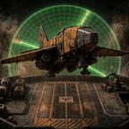

<p align="center">
  
</p>

<h1 align="center">🛸 WePlay: Radar Probe Drone Launcher</h1>

<p align="center"><i>It's scary out there. You sit, we scan.</i> 📡</p>

<p align="center">
  <a href="https://mods.factorio.com/mod/WePlayRadarProbeDroneLauncher">Mod Portal</a> ·
  <a href="#-features">Features</a> ·
  <a href="#-settings">Settings</a> ·
  <a href="#-development">Development</a>
</p>

---

A Factorio mod that replaces driving into the fog with drones. Each drone is a tiny airplane. Build a **launch pad** and load it with **survey drones**. Each drone flies to the nearest uncharted land, lands, and deploys a **radar probe** that slowly sweeps the area, then shuts down. It works as an early-game alternative to scouting by car. 🚗➡️🛸

## ✨ Features

- 🏗️ **Drone Launcher**: a 5×5 launch pad. Inserters load the drones, and it launches one every 30 seconds. Its runway can face any of the four directions: rotate it with **R** while placing, or press **R** over a placed launcher.
- 🛫 **Real airplane flights**: drones roll down the runway, climb out, and **bank into smooth turns** toward their target (the wings visibly dip as they roll into the turn), then fly a straight final approach to land.
- ✈️ **Survey Drones**: one-way scouts that fly to the **nearest uncharted land**. They spread out so they don't scout the same spot twice.
- 📡 **Survey Probes**: a probe with a spinning dish that sweeps an **8-chunk radius** (256 tiles) for a few minutes, then powers down.
- 🛟 **Survey Buoys**: a drone that lands on water inflates a raft and scans from there.
- 🔁 **Never idle**: once everything in range is charted, the airplanes keep flying out to refresh the map.
- 🗺️ **Map links**: each finished sweep posts a clickable map location in chat.
- 👀 **Follow the flight**: an optional map icon and a narrow charted trail let you watch a drone from launch to landing.
- 🪐 **Works on every planet.**

## 🔬 Research

| Technology | Unlocks | Cost |
|---|---|---|
| **Survey drones** *(after Radar + Engine)* | Drone Launcher, Survey Drone | 100 × 🔴🟢 |
| **Survey drone range 1** | +1,024 tiles (2,048 total) | 150 × 🔴🟢 |
| **Survey drone range 2** | +2,048 tiles (4,096 total) | 300 × 🔴🟢🔵 |
| **Survey drone range 3** | +4,096 tiles (**8,192 total**) | 450 × 🔴🟢🔵 |

## 🛠️ Recipes

| Item | Ingredients |
|---|---|
| **Survey Drone** | 1 radar, 1 engine unit, 4 steel plates, 4 electronic circuits |
| **Drone Launcher** | 50 steel plates, 50 stone bricks, 20 electronic circuits, 10 engine units, 4 radars |

## ⚙️ Settings

**Startup**

| Setting | Default | |
|---|---|---|
| ⏱️ Launch interval | 30 s | Launch prep time per drone |
| 📏 Drone base range | 1,024 tiles | Range before any research |
| 📈 First range research bonus | 1,024 tiles | Each later level doubles it |

**Map** (can be changed mid-game)

| Setting | Default | |
|---|---|---|
| 💨 Drone flight speed | 30 tiles/s | Lower it to watch them fly |
| 🛫 Fancy flight paths | On | Runway takeoff, banking turn and final approach. Off = straight lines |
| 🛩️ Banking turns | On | Airplanes visibly roll into their turns |
| 👀 Show drones on the map | Off | Map icons plus a narrow charted flight trail |
| 🎯 Landing mode | Nudge | **Nudge**: bad landings slide to the nearest valid spot · **Fail**: lava, cliffs and buildings destroy the drone 💥 · **Risky**: nudge, with random malfunctions 🎲 |
| 🎲 Risky failure chance | 10% | Only used in Risky mode |
| 💬 Announce finished probes | On | Chat message with a map link |

## 📦 Installation

**From the Mod Portal (recommended):** in Factorio, open **Mods → Install**, search for *Radar Probe Drone Launcher*, and install it.

**Manually:** download the latest release zip and drop it, unzipped, into your Factorio `mods` folder:

| OS | Path |
|---|---|
| Windows | `%APPDATA%\Factorio\mods` |
| Linux | `~/.factorio/mods` |
| macOS | `~/Library/Application Support/factorio/mods` |

**Requires Factorio 2.1.** Space Age is optional. Works with **Krastorio 2** and **Space Exploration**: the launcher and drone get their own crafting-menu row right after the radar's.

## 🧭 How it works

1. The launcher is an assembling machine with a fixed "launch" recipe that uses up one drone. `control.lua` watches its finished-craft counter, and each finished craft launches one drone.
2. There's one launcher prototype per runway direction. Players and robots build a rotatable placer, which the script swaps for the launcher facing the same way. **R** over a placed launcher swaps it again (the same approach as WePlay: Long Haul Logistics).
3. Drones aren't entities. Each one is a pair of sprites (body and shadow) that the script draws and moves every tick along a path: a takeoff roll down the runway, a straight climb-out, then a shortest turn-radius path (arc, straight, arc) onto a straight final approach. Speed ramps up on the runway and eases off on approach, and altitude climbs and descends smoothly. Banking is faked by squeezing the sprite along its wing axis in turns (approximated with screen-axis `x_scale` / `y_scale`) and sliding it toward the inside of the turn.
4. To pick a target, the script casts 48 rays outward from the launcher and takes the closest uncharted chunk that no other drone has claimed. It then pushes the target past the edge of the charted area, so the probe's sweep covers mostly new ground.
5. On landing, a smoke or splash effect hides the swap to a **probe** (a `radar` with a void energy source) or a **buoy** (the same radar with a water-only collision mask). Whichever form fits closest to the landing spot wins.
6. The probe is removed after it has had time to scan every chunk in its radius once.

Balance numbers (scan radius, sweep speed, flight path geometry, banking, nudge distance, trail spacing) live in [`shared.lua`](shared.lua).

## 🎨 Development

### Repository layout

```
├── info.json            # mod metadata
├── settings.lua         # mod settings
├── shared.lua           # constants shared by data + control stages
├── data.lua             # prototypes: items, recipes, entities, tech, sprites, sounds
├── data-final-fixes.lua # moves the crafting-menu row next to the radar after overhauls finish
├── control.lua          # runtime: launching, flight, targeting, landing, probe lifetime
├── changelog.txt
├── thumbnail.png
├── locale/en/locale.cfg
├── sounds/              # drone-launch.ogg, drone-flying.ogg
├── graphics/
│   ├── icons/
│   └── entity/          # sprite sheets + generated <name>.lua sprite metadata
└── tools/
    └── pack_sprites.py  # sprite sheet packer (Python 3 + Pillow)
```

### Art pipeline

All models are made and rendered in **Blender**, with an orthographic camera at **64 px per tile** (ortho scale = resolution ÷ 64) and **1 Blender unit = 1 tile**.

1. Render every rotation frame (64 directions) as separate **diffuse** and **shadow** passes. The shadow pass uses a shadow catcher, with the model set to *Indirect Only* in that view layer.
2. Pack the frames with [`tools/pack_sprites.py`](tools/pack_sprites.py) (needs `pip install pillow`):

   ```bash
   python tools/pack_sprites.py --name probe --alpha-threshold 16
   ```

   Run `python tools/pack_sprites.py --help` to see all options.

   This trims the empty border shared by all frames and lays them out 8 per row. It also writes `probe.lua` with each layer's size and `shift`.
3. Copy the PNGs and the `.lua` file into `graphics/entity/`. `data.lua` loads the metadata automatically, so the shadows line up without any hand-tuned numbers.

> 💡 Use `--alpha-threshold 16` for shadow passes. Shadow catchers leave a faint haze across the whole frame, and without the threshold the frames don't get trimmed.

The launcher is a 4-frame sheet (north, east, south, west), packed the same way with 4 directions.

### Testing

The fastest way to try changes is a fresh sandbox save and these console commands (they disable achievements):

```lua
/c game.player.force.technologies["rpdl-survey-drones"].researched = true
/c game.player.insert{name="rpdl-drone-launcher", count=1} game.player.insert{name="rpdl-survey-drone", count=10}
```

Setting **Launch interval** to a few seconds also helps.

## 🐛 Bugs & ideas

Please report bugs and suggest features in the [Issues](../../issues) tab or on the mod portal's discussion page. Include your Factorio version, your mod list, and the error text or a screenshot if there is one. 💛

## 💛 Credits

Models, renders, sprites, and sounds by **afewvowels**. Part of the **WePlay** mod collection.

## 📄 License

Released into the public domain under [The Unlicense](LICENSE). Do whatever you like with it! 🎉
